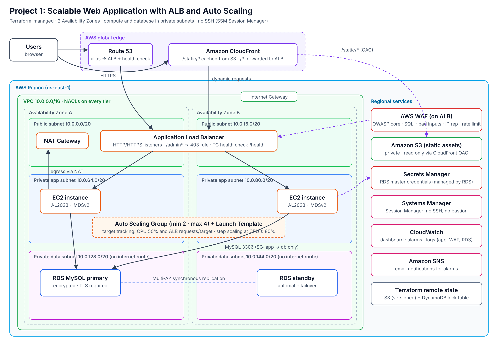

# AWS Solutions Architect – Associate 

## Scalable Web Application on AWS with ALB, Auto Scaling and Multi-AZ RDS

**AWS Solutions Architect – Associate graduation project (Manara) · Project 1 · EC2-based architecture · 100% Terraform**

A production-style web application deployed in a custom VPC across two Availability Zones. Traffic enters through **CloudFront**, is filtered by **AWS WAF**, load-balanced by an **Application Load Balancer** and served by an **EC2 Auto Scaling Group** in private subnets. Data lives in a **Multi-AZ Amazon RDS for MySQL** database with automatic failover. Instances are managed through **SSM Session Manager**, so there is no SSH and no bastion host. Everything is observable through a **CloudWatch dashboard**, with alarms sent to **SNS**.

---

## Table of contents
1. [Architecture](#architecture)
2. [AWS services used](#aws-services-used)
3. [How a request flows](#how-a-request-flows)
4. [Design decisions](#design-decisions)
5. [Repository structure](#repository-structure)
6. [Deployment](#deployment)
7. [Testing the solution](#testing-the-solution)
8. [Cost estimate](#cost-estimate)
9. [Cleanup](#cleanup)
10. [Learning outcomes](#learning-outcomes)

---

## Architecture



> Source: [`docs/architecture.svg`](docs/architecture.svg)

| Tier | Subnets (per AZ) | Contents | Internet access |
|------|------------------|----------|-----------------|
| Public | `10.0.0.0/20`, `10.0.16.0/20` | ALB, NAT Gateway | Inbound + outbound via Internet Gateway |
| Private app | `10.0.64.0/20`, `10.0.80.0/20` | EC2 instances (ASG) | Outbound only, via NAT Gateway |
| Private data | `10.0.128.0/20`, `10.0.144.0/20` | RDS primary + standby | None (no route to the internet) |

---

## AWS services used

| Service | What it does here | Terraform |
|---------|-------------------|-----------|
| **Amazon VPC** | 2 AZs × 3 tiers of subnets, Internet Gateway, NAT Gateway, route tables per tier, **Network ACLs** per tier, chained **Security Groups** | `modules/network`, `modules/security` |
| **Amazon EC2 + Auto Scaling** | **Launch Template** (Amazon Linux 2023, IMDSv2, encrypted gp3), ASG min 2 / max 4 across both AZs, ELB health checks, rolling instance refresh | `modules/compute` |
| **Scaling policies** | **Target tracking** on average CPU (50%) and on ALB requests per target; **step scaling** that adds +1/+2 instances when CPU ≥ 80% | `modules/compute` |
| **Application Load Balancer** | Layer 7 load balancing, target group health check on `/health`, HTTP→HTTPS redirect when a certificate is set, **listener rule** returning 403 for `/admin*` | `modules/alb` |
| **AWS WAF** | Web ACL on the ALB: AWS managed **Core rule set (OWASP Top 10)**, SQL injection, known bad inputs, IP reputation, plus a **rate-based rule** per IP. Logs go to CloudWatch Logs. | `modules/alb` |
| **Amazon CloudFront** | Single HTTPS entry point. `/static/*` is cached from a private S3 bucket through **Origin Access Control**, and all other paths go to the ALB uncached. | `modules/edge` |
| **Amazon S3** | Private, encrypted, versioned bucket for static assets | `modules/edge` |
| **Amazon RDS (MySQL) Multi-AZ** | Synchronous standby in AZ B with automatic failover, encrypted storage, TLS enforced, 7-day automated backups, error and slow-query logs exported to CloudWatch | `modules/database` |
| **AWS Secrets Manager** | The RDS master password is generated and stored by RDS (`manage_master_user_password`), so it never appears in code or state. EC2 reads it at runtime with least-privilege IAM. | `modules/database`, `modules/compute` |
| **Amazon Route 53** | *(optional, needs a domain)* Alias A record → ALB, HTTP **health check** on `/health`, failover routing (PRIMARY) | `modules/dns` |
| **AWS Systems Manager** | **Session Manager** shell access to private instances, with no port 22, no key pairs and no bastion | `modules/compute` (IAM role) |
| **Amazon CloudWatch** | Dashboard (ALB, ASG, RDS, WAF), alarms (5xx, unhealthy hosts, p95 latency, RDS CPU and storage, WAF block spikes), CloudWatch agent for memory and disk metrics plus logs | `modules/monitoring`, `modules/compute` |
| **Amazon SNS** | Email notifications for every alarm | `modules/monitoring` |
| **IAM** | Instance role with only SSM, CloudWatch agent and `GetSecretValue` on the one DB secret | `modules/compute` |
| **S3 + DynamoDB (state)** | Remote Terraform state with versioning, encryption and state locking | `bootstrap/` |

---

## How a request flows

1. The user opens `https://<distribution>.cloudfront.net`, or `app.<your-domain>` via Route 53.
2. **CloudFront** serves `/static/*` (CSS and images) from the edge cache, which is filled from **S3** through OAC. Every other path goes to the **ALB**.
3. **WAF** inspects the request at the ALB. SQLi, XSS, known-bad IPs and request floods are blocked.
4. The **ALB** forwards the request to a healthy **EC2** instance in either AZ.
5. The app on EC2 reads the DB credentials from **Secrets Manager** and queries **RDS** over TLS. The page shows **which instance and AZ served it** and a visit counter stored in MySQL, which makes load balancing and failover easy to demo.
6. Metrics and logs flow to **CloudWatch**, and alarms notify **SNS** subscribers.

---

## Design decisions

| Decision | Why |
|----------|-----|
| Three subnet tiers, RDS in subnets with **no internet route** | Defense in depth: the database cannot reach or be reached from the internet even if a security group is misconfigured. |
| Security groups chained by **reference** (ALB SG → App SG → DB SG) | Only the ALB can reach instances, and only instances can reach MySQL. Rules don't depend on IP ranges. |
| **NACLs** in addition to security groups | Stateless subnet-level guardrail, for example data subnets accept 3306 only from the app subnet CIDRs. |
| **Session Manager** instead of a bastion | No open SSH port, no key management, and every session is auditable in CloudTrail. |
| **IMDSv2 required** | Mitigates SSRF-based credential theft from instance metadata. |
| `manage_master_user_password` | AWS generates and stores the password, so no secret appears in `tfvars` or Terraform state. |
| `single_nat_gateway = true` by default | Cuts cost for the demo. Set it to `false` to get **one NAT per AZ** for true AZ-independent egress (production). |
| Target tracking + step scaling | Target tracking handles steady load. Step scaling reacts faster to sudden spikes. |
| CloudFront in front of the ALB | Edge caching of static assets lowers latency and offloads the ALB and EC2. Set `alb_ingress_cidrs = []` to allow **only CloudFront** IPs to reach the ALB. |
| Remote state with locking | Safe collaboration, and state history is kept with S3 versioning. |

---

## Repository structure

```
.
├── bootstrap/                 # one-time: S3 state bucket + DynamoDB lock table
├── envs/
│   └── dev/                   # root module for the dev environment
│       ├── main.tf            # wires all modules together
│       ├── variables.tf
│       ├── outputs.tf
│       ├── versions.tf        # providers + S3 backend
│       ├── terraform.tfvars.example
│       ├── backend.hcl.example
│       └── tests/plan.tftest.hcl   # offline test with a mocked AWS provider
├── modules/
│   ├── network/               # VPC, subnets, IGW, NAT, route tables, NACLs
│   ├── security/              # security groups
│   ├── compute/               # IAM role, launch template, ASG, scaling policies, demo app
│   ├── alb/                   # ALB, target group, listeners, rules, WAF
│   ├── database/              # RDS MySQL Multi-AZ
│   ├── edge/                  # S3 static bucket, CloudFront + OAC
│   ├── dns/                   # Route 53 alias + health check (optional)
│   └── monitoring/            # SNS, CloudWatch alarms, dashboard
└── docs/
    ├── architecture.svg
    └── architecture.png
```

---

## Deployment

### Prerequisites
- An AWS account and the AWS CLI configured (`aws configure` or SSO)
- Terraform ≥ 1.6
- *(optional)* a Route 53 hosted zone and an ACM certificate

### 1. Create the remote state backend (one time)
```bash
cd bootstrap
terraform init
terraform apply
# note the outputs: state_bucket, lock_table
```

### 2. Configure the environment
```bash
cd ../envs/dev
cp backend.hcl.example backend.hcl            # fill in the bucket name from step 1
cp terraform.tfvars.example terraform.tfvars  # set alert_email, optional domain_name
```

### 3. Deploy
```bash
terraform init -backend-config=backend.hcl
terraform fmt -check -recursive ../..
terraform validate
terraform test          # offline, mocked provider: no AWS calls
terraform plan -out tfplan
terraform apply tfplan
```
RDS Multi-AZ takes about 10–15 minutes. When it finishes, Terraform prints:
```
cloudfront_url = "https://dxxxxxxxx.cloudfront.net"
alb_url        = "http://manara-p1-dev-alb-xxxx.us-east-1.elb.amazonaws.com"
dashboard_url  = "https://console.aws.amazon.com/cloudwatch/home?...#dashboards:name=manara-p1-dev-overview"
```
Confirm the SNS subscription email to receive alarms.

---

## Testing the solution

| Test | How | Expected |
|------|-----|----------|
| Load balancing across AZs | Refresh `cloudfront_url` several times | Instance ID and AZ alternate between the two AZs |
| DB connectivity | Look at the page | `Database (RDS Multi-AZ): connected, total visits: N` |
| CloudFront caching | `curl -I <cloudfront_url>/static/style.css` twice | Second response has `x-cache: Hit from cloudfront` |
| Self-healing | Terminate one instance in the EC2 console | ALB marks it unhealthy and the ASG launches a replacement |
| Auto Scaling | Session Manager → `sudo dnf install -y stress-ng && stress-ng --cpu 2 --timeout 600` | CPU alarm fires and the ASG scales out to 3–4 instances, then back in |
| Load-based scaling | `hey -z 5m -c 50 <alb_url>/` (or `ab`) | `ALBRequestCountPerTarget` policy adds instances |
| WAF: SQL injection | `curl "<alb_url>/?id=1%27%20OR%20%271%27=%271"` | `403 Forbidden` from WAF |
| WAF: rate limit | > 1000 requests in 5 min from one IP | IP is blocked temporarily |
| L7 rule | `curl <alb_url>/admin` | `403 Forbidden` from the ALB listener rule |
| RDS failover | `aws rds reboot-db-instance --db-instance-identifier manara-p1-dev-mysql --force-failover` | App reconnects after about 60–120 s, and the visit counter keeps its value |
| Bastion-free access | `aws ssm start-session --target <instance-id>` | Shell on a private instance, with no SSH |
| Alarms | Stop the app on both instances: `sudo systemctl stop webapp` | Unhealthy-hosts alarm email from SNS |

---

## Cost estimate

Approximate cost in us-east-1 with the defaults (on-demand, light traffic):

| Resource | ≈ per day |
|----------|-----------|
| NAT Gateway (1) | $1.10 + data |
| ALB | $0.55 |
| EC2 t3.micro × 2 | $0.50 |
| RDS db.t3.micro Multi-AZ | $0.82 |
| WAF (web ACL + 5 rules) | $0.33 |
| CloudFront, S3, CloudWatch, SNS, Secrets Manager | < $0.20 |
| **Total** | **≈ $3.50/day** |

> Deploy, record the demo, then **destroy**. Free-tier hours may reduce the EC2 cost.

---

## Cleanup

```bash
cd envs/dev
terraform destroy
```
The `bootstrap/` bucket has `prevent_destroy` so the state isn't lost by accident. To remove it too, delete that lifecycle block, empty the bucket, and run `terraform destroy` in `bootstrap/`.

---

## Learning outcomes

| Outcome (from the project brief) | Where it is implemented |
|----------------------------------|-------------------------|
| Design VPCs with correct subnet, route table and NAT Gateway configurations | `modules/network`: 3 tiers, per-AZ private route tables, NAT, isolated data tier |
| Build highly available architectures across multiple AZs | ALB, ASG and RDS Multi-AZ all span 2 AZs |
| Configure ALB listener rules and target group health checks | `modules/alb`: `/health` check, HTTPS redirect, `/admin*` rule |
| Implement Auto Scaling with target tracking and step scaling policies | `modules/compute`: CPU + request-count target tracking, CPU step scaling |
| Secure applications with WAF, Security Groups and private subnets | `modules/alb` (WAF), `modules/security`, NACLs, private app and data tiers |
| Use Systems Manager Session Manager as a bastion-free access alternative | `modules/compute`: `AmazonSSMManagedInstanceCore`, no SSH, IMDSv2 |

---

## Author

**Mohamed Aziz**, Manara AWS Solutions Architect – Associate cohort
